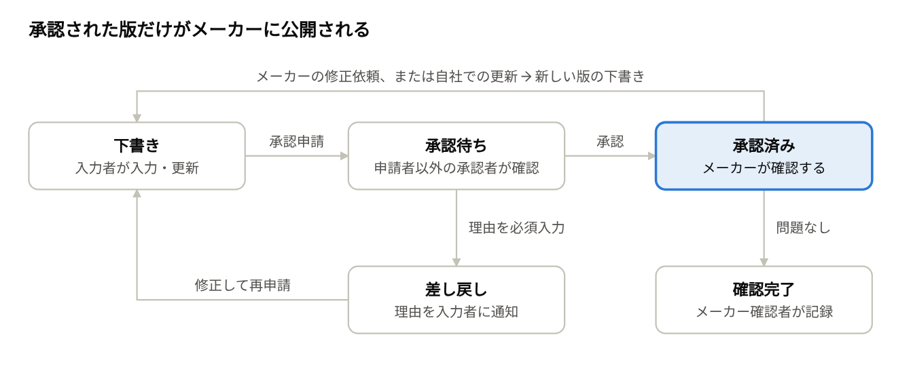
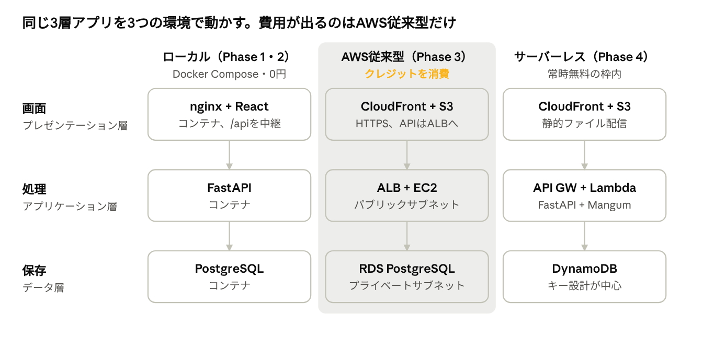

# ECU セキュリティ対策状況の管理システム（ecu-sec-3tier）

サプライヤが ECU のセキュリティ対策状況を入力・承認し、メーカー（OEM）が承認済みの内容を一括で確認する業務システム。
同じ3層のアプリ（画面・処理・保存）を、**ローカル → AWS 従来型 → AWS サーバーレス** の3通りで動かし、構成の違いを説明できるようになることを目指す個人の練習プロジェクト。

> 状態：2026-11-22 に開始（Day 1／18）。1日5時間 × 17日＋予備1日（約85時間の見積もり）。AWS の請求は 0円に保つ

データはすべて架空（ダミー）。実在の会社・ECU・対策の情報は含まない。

## 何を作るか

各 ECU サプライヤが、自社 ECU の対策状況（セキュアブート、メッセージ認証（SecOC）、デバッグポートの無効化、鍵管理、更新ソフトの署名検証、脆弱性の監視など）を入力し、社内で承認する。メーカーは、承認済みの内容だけを全 ECU 分まとめて確認し、確認完了か修正依頼を記録する。

| 所属 | 役割 | できること |
| --- | --- | --- |
| メーカー | システム管理者 | 会社・ECU・対策項目の登録、全社のユーザー管理、監査ログの閲覧 |
| メーカー | 確認者 | 全 ECU の承認済み内容の一括閲覧、確認完了の記録、修正依頼、質問コメント、CSV 出力 |
| サプライヤ | 管理者 | 自社ユーザーの追加・役割変更・無効化 |
| サプライヤ | 入力者 | 自社 ECU の対策状況の入力・更新、承認申請 |
| サプライヤ | 承認者 | 自社の申請の承認・差し戻し、メーカーへの回答コメント |

### 承認フロー



- 承認済みの版は上書きしない。更新は新しい版を作り、新しい版が承認されるまでメーカーには前の承認版を見せる
- 申請者本人は承認できない（職務分離）。差し戻し・修正依頼には理由が必須
- 状態の変更は画面ではなく API 側で検証し、すべて監査ログに残す

詳しい仕様は [docs/spec.md](docs/spec.md)。

## 3層 × 3つの環境



| 層 | ローカル（Phase 1・2） | AWS 従来型（Phase 3） | AWS サーバーレス（Phase 4） |
| --- | --- | --- | --- |
| 画面（プレゼンテーション層） | React（Vite・TypeScript）＋ nginx | S3 ＋ CloudFront | S3 ＋ CloudFront |
| 処理（アプリケーション層） | Python（FastAPI） | EC2 のコンテナ（ALB の後ろ） | Lambda（FastAPI ＋ Mangum）＋ API Gateway |
| 保存（データ層） | PostgreSQL（Docker） | RDS for PostgreSQL（プライベートサブネット） | DynamoDB |

アプリのコードはほぼそのままで、動かす場所だけを変える。2つの AWS 構成の比較表は Day 17 にここへ書く。

## 進み具合

| スプリント | Day | ゴール | 状態 |
| --- | --- | --- | --- |
| 1 | 1〜3 | 準備が終わり、API で対策状況を保存できる | 進行中（Day 1） |
| 2 | 4〜6 | ローカルで3層が動き、ログインできる | |
| 3 | 7〜9 | 会社ごとのデータ分離、承認フロー、メーカーの修正依頼・コメントが動く | |
| 4 | 10〜12 | 管理機能と CI が完成。AWS 上に RDS ができる | |
| 5 | 13〜15 | AWS 従来型が完成し、DynamoDB のキー設計ができる | |
| 6 | 16〜18 | サーバーレス版の完成と比較表 | |

Day ごとの作業と完了条件は [docs/schedule.md](docs/schedule.md)、毎日の記録は [docs/devlog/](docs/devlog/)。

### 完了条件（すべて満たしたら終了）

1. ローカルの Docker Compose で、画面・API・DB の3層が1コマンドで起動する
2. サプライヤの入力 → 承認 → メーカーでの一括確認 → 修正依頼・質問への回答が、画面から一通りできる
3. サプライヤ A のユーザーが、サプライヤ B のデータを読めないことを自動テストで確認し、GitHub Actions で通る
4. AWS 上の従来型構成（ALB・EC2・RDS）を Terraform で作り、動作確認後に削除できる
5. 同じ機能をサーバーレス構成でも動かし、2つの構成の違いを自分の言葉で説明できる
6. 期間中の AWS 請求額が 0円である

## 動かし方（ローカル）

Docker Desktop が必要。

```powershell
# 環境変数のファイルを作り、パスワードを長い乱数に変える（Git の対象外）
Copy-Item env.example .env

# 起動（Day 1 の時点では DB だけ。API は Day 3、画面は Day 4 に足す）
docker compose up -d
docker compose ps

# 止める（データは残る。-v を付けるとデータも消える）
docker compose down
```

## 使用技術

| 分野 | 技術 |
| --- | --- |
| 画面 | React、Vite、TypeScript、Vitest、nginx |
| 処理 | Python、FastAPI、SQLAlchemy、Alembic、pytest、ruff、uv |
| 保存 | PostgreSQL 18、Amazon RDS、Amazon DynamoDB |
| 認証 | bcrypt（パスワードのハッシュ化）、JWT |
| コンテナ | Docker、docker compose |
| インフラのコード化 | Terraform |
| AWS（Phase 3） | VPC、セキュリティグループ、EC2、ALB、RDS、Systems Manager、S3、CloudFront、SSM Parameter Store |
| AWS（Phase 4） | Lambda、API Gateway、DynamoDB、S3、CloudFront |
| CI | GitHub Actions、Dependabot |
| 進め方 | Jira（スクラム、3日で1スプリント）、Claude Code |

## セキュリティ

この題材でいちばん大事なのは、**あるサプライヤのユーザーが、別のサプライヤのデータを読めないこと**。

- すべての API で、ログインユーザーの会社でデータを絞り込む（画面で隠すだけにしない）。コメントも同じ
- 他社のデータには 403 ではなく 404 を返し、存在も分からないようにする
- 新しい API を足すときは、他社のユーザーで呼んで 404 になるテストを同じ PR に入れる
- 秘密情報はリポジトリに含めない。ローカルは `.env`（Git の対象外）、AWS では SSM Parameter Store
- RDS はプライベートサブネットに置き、EC2 への接続は SSH ではなく Systems Manager（22番ポートを開けない）
- 脆弱性の報告：[SECURITY.md](SECURITY.md)（GitHub の非公開の報告の仕組みを使う）

主な設計判断と「採らなかったら何が起きるか」は [docs/design-decisions.md](docs/design-decisions.md)。

## 費用ゼロのガードレール

AWS は無料プランのクレジットの範囲で使い、請求を 0円に保つ。

- やらない：NAT Gateway、RDS のマルチ AZ・大きなインスタンス、独自ドメインの購入、使わない Elastic IP、Secrets Manager、有料プランへの切り替え
- AWS を使う日は、始めに残りのクレジットを確かめ、終わりに `terraform destroy` して使用量を確かめる
- Claude Code の Hook（`guard-aws-cost`）が、上の「やらない」を Terraform のファイルと aws CLI の段階で止める

## Claude Code の使い方

コードは Claude Code が書き、オーナーは依頼・動作確認・判断を担当する。練習の目的は「オーナーが説明できるようになること」なので、設計の理由も説明させる。

- 1ストーリーの進め方：Plan モードで設計案 → オーナーが承認 → テストを先に書く（落ちることを確かめる）→ 実装 → 確かめてコミット
- Hook・スキル・サブエージェント・権限の一覧と理由：[docs/claude-setup.md](docs/claude-setup.md)
  - 例：秘密情報のファイルへの操作を止める、費用のかかる AWS の構成を止める、レビューなしの PR を止める、完了条件の証拠なしに Jira の課題を完了にしない
- 決まりの全体：[CLAUDE.md](CLAUDE.md)

## ドキュメント

| ファイル | 内容 |
| --- | --- |
| [3層クライアントサーバー開発 練習計画.docx](<3層クライアントサーバー開発 練習計画.docx>) | 計画書（元） |
| [docs/spec.md](docs/spec.md) | 仕様（役割と権限、画面、テーブル、承認フロー） |
| [docs/schedule.md](docs/schedule.md) | 日割りとスプリント |
| [docs/design-decisions.md](docs/design-decisions.md) | 設計判断と、採らなかった場合に起きること |
| [docs/claude-setup.md](docs/claude-setup.md) | Claude Code の設定（Hook・スキル・サブエージェント・権限） |
| [docs/devlog/](docs/devlog/) | 毎日の記録 |
| [docs/handoff.md](docs/handoff.md) | 次の作業への引き継ぎ |

## 素材の出典

| 素材 | 作者・出典 | ライセンス |
| --- | --- | --- |
| 図（`docs/images/`） | 自作（計画書の図） | – |
| ダミーデータ | 自作（架空の会社名・品番） | – |
