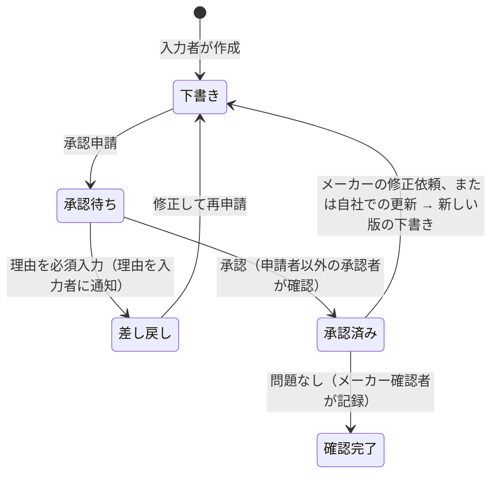

# 仕様：ECU セキュリティ対策状況の管理システム

元は計画書（`3層クライアントサーバー開発 練習計画.docx`）の第2章。違いがあれば計画書を正とし、ここを直す。仕様を変えるときはオーナーの承認が要る（CLAUDE.md「必ず止まる」6）。

各 ECU サプライヤが自社 ECU の対策状況を入力し、社内で承認する。メーカーは、承認済みの内容だけを全 ECU 分まとめて確認する。データはすべてダミーとし、会社の情報は使わない。

## 役割と権限

サプライヤのユーザーは自社のデータだけを扱える。自分が申請したものは自分で承認できない（職務分離）。

| 所属 | 役割 | できること |
| --- | --- | --- |
| メーカー | システム管理者 | 会社・ECU・対策項目の登録、全社のユーザー管理、監査ログの閲覧 |
| メーカー | 確認者 | 全 ECU の承認済み内容の一括閲覧、確認完了の記録、修正依頼、質問コメント、CSV 出力 |
| サプライヤ | 管理者 | 自社ユーザーの追加・役割変更・無効化 |
| サプライヤ | 入力者 | 自社 ECU の対策状況の入力・更新、承認申請 |
| サプライヤ | 承認者 | 自社の申請の承認・差し戻し、メーカーへの回答コメント |

## 対策項目と入力内容

メーカーが対策項目を定義し、全サプライヤが同じ項目に答える。項目の例：セキュアブート、メッセージ認証（SecOC）、デバッグポートの無効化、鍵管理、更新ソフトの署名検証、脆弱性の監視。

1項目ごとに入力するもの：

- 状態：対応済み・対応中・未対応・対象外
- 根拠の説明
- 対応予定日（対応中・未対応のとき）

## 画面

| 画面 | 内容 | 使う役割 |
| --- | --- | --- |
| ログイン | メールアドレス・パスワード | 全員 |
| 自社 ECU 一覧 | ECU ごとの最新の状態（下書き・承認待ち・承認済み） | サプライヤ全員 |
| 対策状況の入力 | 項目ごとの入力、下書き保存、承認申請 | 入力者 |
| 承認待ち一覧・承認 | 前回承認版との差分を見て承認・差し戻し | 承認者 |
| 一括確認マトリクス | 行＝ECU、列＝対策項目、セル＝状態。サプライヤ・状態・確認状況（未確認・確認完了・修正依頼中）で絞り込み、CSV 出力 | メーカー |
| ECU 詳細・履歴 | 承認済み版の一覧、版ごとの差分、メーカーとのコメントのやり取り（未読表示あり） | 全員（自社分または全社） |
| ユーザー管理 | 追加・役割変更・無効化 | システム管理者、サプライヤ管理者 |
| マスタ管理 | 会社・ECU・対策項目の登録 | システム管理者 |
| 監査ログ | 誰がいつ何をしたか | システム管理者 |

## データ（テーブル）

申請を「版」として保存し、承認済みの版は書き換えない。更新するときは新しい版を作るので、過去の状態をたどれる。

| テーブル | 主な列 |
| --- | --- |
| companies | id, name, type（oem / supplier） |
| users | id, company_id, email, password_hash, role, is_active |
| ecus | id, supplier_id, name, part_no, vehicle_model |
| measure_items | id, code, title, description, sort_order |
| assessments（申請の単位） | id, ecu_id, version, status, submitted_by, approved_by, submitted_at, approved_at, reject_reason, review_status, reviewed_by, reviewed_at |
| assessment_entries | id, assessment_id, item_id, status, evidence, planned_date |
| audit_logs | id, user_id, action, target, ip, created_at |
| comments | id, assessment_id, item_id（任意）, parent_id, author_id, kind（質問 / 回答 / 修正依頼）, body, created_at |
| comment_reads | user_id, comment_id, read_at（未読判定用） |

## 承認フロー

版の状態は4つ：下書き・承認待ち・差し戻し・承認済み。承認済みの版に、メーカー確認者が「確認完了」を記録する（計画書の図「承認された版だけがメーカーに公開される」）。

（2026-11-22：計画書の図と突き合わせて直した。「確認完了」は版の状態ではなく、承認済みの版に付ける確認状況 `review_status`）

- 承認済みの版に対して、メーカー確認者は「確認完了」か「修正依頼」を記録する（`review_status`：未確認・確認完了・修正依頼中）。修正依頼には理由を必須とし、サプライヤが新しい版を作って再申請する。新しい版が承認されるまで、メーカーには前の承認版が表示され続ける
- 質問は状態を変えない。ECU 全体または対策項目ごとにメーカーが質問し、サプライヤが同じスレッドで回答する。コメントはその ECU のサプライヤとメーカーだけが読める
- 通知は画面内の未読表示だけとし、メール送信は使わない（費用と設定の手間を避けるため）
- 状態の変更は必ず API 側でチェックする（例：承認済みの版は編集できない、申請者本人は承認できない）。すべての状態変更とコメントを監査ログに残す

## 会社ごとのデータ分離（計画書 第4章。この題材で一番重要）

画面で隠すだけでなく、すべての API でログインユーザーの会社で絞り込む。他社のデータには 403 ではなく 404 を返し、存在も分からないようにする。
